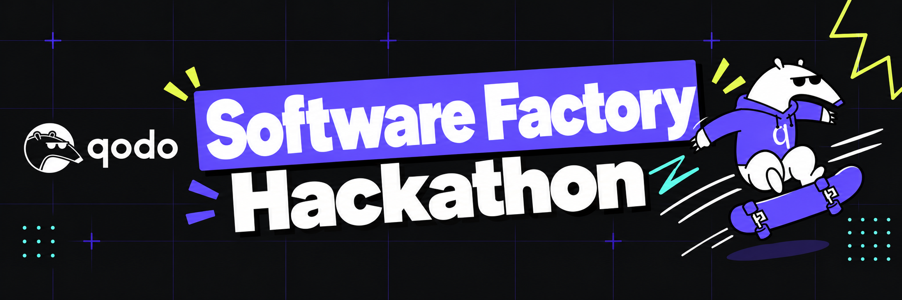

# Software Factory Hackathon

This repository provides participation guidance and submission templates for Qodo's Software Factory Hackathon, November 2–December 2, 2026.

Build your own software factory: connect coding agents, project standards, tests, and Qodo code reviews to take an idea through to a reviewed pull request.

## Start here

1. [Register for the hackathon](https://hackathon.qodo.ai/#join).
2. Read the [official rules and eligibility requirements](https://hackathon.qodo.ai/rules/).
3. Create a Qodo account and use Qodo during the hackathon. Qodo provides free licenses for the event; follow each challenge's instructions on when to use it.
4. Follow the [daily challenges](https://hackathon.qodo.ai/challenges/) and the instructions in your hackathon emails.
5. Build in your own project repository, using your chosen coding agent. This hub is not a mandatory starter project.
6. Submit each completed challenge to its official daily GitHub Discussion, using the [daily submission template](templates/daily-submission.md).

New challenges arrive on weekdays. Weekends have no new challenges, and you may catch up on missed days. Official challenge instructions and submission links are provided in the daily emails.

## Participate

- [Discussions](https://github.com/qodo-hackathon/software-factory-hackathon/discussions): official challenge threads, announcements, and help.
- [Daily submission template](templates/daily-submission.md): copy it into a reply to the appropriate daily thread.
- [Final submission template](templates/final-submission.md): use with the official final-submission instructions.
- [Contribution guide](CONTRIBUTING.md): where to share work and ask questions.
- [Qodo documentation](https://docs.qodo.ai/): product setup and guidance.

Keep your project in your own repository rather than submitting its code as a pull request to this hub. A project repository or social post alone does not count as an entry; follow the official Discussion submission instructions. Social sharing is optional.

## Share safely

This is a public repository and public discussion space. Do not post credentials, confidential company information, unauthorized personal data, or material you do not have permission to share. Redact sensitive details from logs, screenshots, and review evidence.

The [official rules](https://hackathon.qodo.ai/rules/) govern eligibility, deadlines, judging, prizes, and rights in submitted work. This hub does not replace them. You retain rights in your original work, subject to existing third-party rights; participating does not transfer ownership of your project to Qodo.
